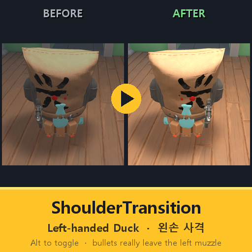
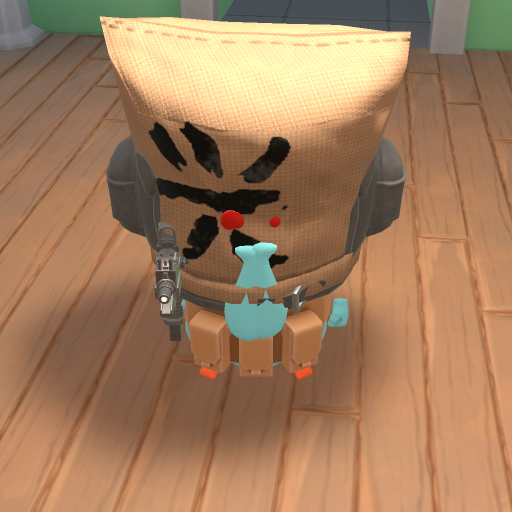
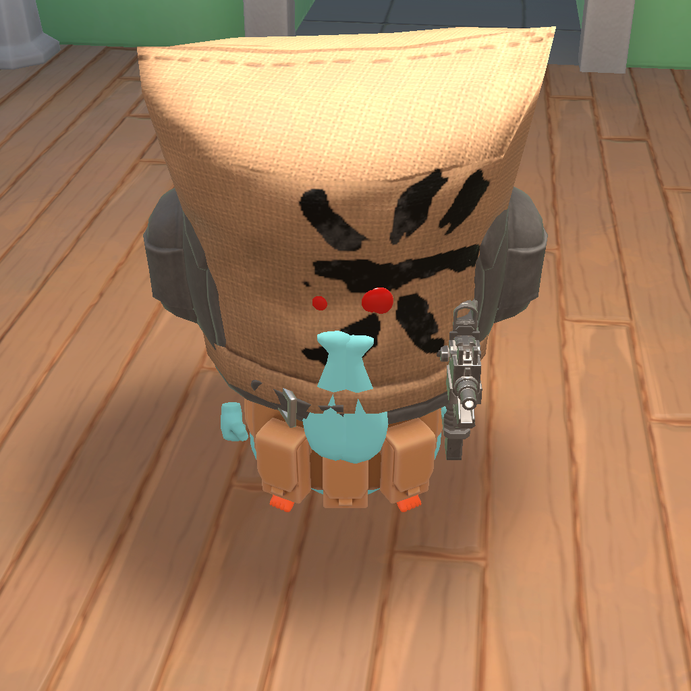

# ShoulderTransition

**Escape From Duckov — 왼손 사격 모드 / Left-handed Duck**

[한국어](#한국어) · [English](#english)

---

## 한국어

오리가 총을 **왼손**으로 들고, 총알도 **왼쪽 총구**에서 나가게 하는 모드입니다.
모델만 뒤집은 것이 아니라 투사체 생성 위치까지 거울상이 되는 것을 검증했습니다.

| 기본 (오른손) | ShoulderTransition (왼손) |
|:---:|:---:|
|  |  |

### 주요 기능

- **왼손 사격** — 총, 총구, 탄 발사 위치가 모두 왼쪽으로. 조준·명중 판정은 그대로.
- **즉시 전환** — `Left Alt` 한 번으로 왼손 ↔ 오른손. 전환할 때 짧은 효과음(기본: 든 총의 장전 철컥).
- **두 가지 방식**
  - `Model` (기본) — 오리 전체를 거울상으로. 손(날개)이 총을 따라가서 완전한 왼손잡이 룩.
  - `Socket` — 무기 소켓만 거울상. 얼굴 무늬·비대칭 장비는 그대로 두고 총만 왼쪽으로.
- **게임 내 설정 창** — [SlimeNull Mod Settings](https://steamcommunity.com/sharedfiles/filedetails/?id=3789464208)가 있으면 설정 → Mod Settings → ShoulderTransition 에서 모든 옵션을 바꿀 수 있습니다. 없으면 `config.json`.
- **코옵 동기화** — 같은 모드를 가진 다른 플레이어가 전환하면 내 화면에서도 **그 사람의** 오리가 바뀝니다.
- **안전** — 내 캐릭터의 시각 요소만 건드립니다. 세이브·스탯·탄도·네트워크 게임 데이터는 바꾸지 않습니다.

### 설치

- **창작마당**: [구독](https://steamcommunity.com/sharedfiles/filedetails/?id=3830017440) → 게임 실행 → 메인 메뉴 **Mods** 에서 켜기 → 재시작.
- **수동**: [Releases](../../releases) 또는 빌드 결과물의 `ShoulderTransition` 폴더(`ShoulderTransition.dll`, `0Harmony.dll`, `info.ini`, `preview.png`)를 `Escape from Duckov\Duckov_Data\Mods\` 에 넣고 Mods 메뉴에서 켜기.
- 필수 의존성 없음. `0Harmony.dll`(2.4.1)을 동봉합니다. 워크샵 HarmonyLib를 같이 쓰면 이 모드를 그 **아래**에 두세요.

### 조작

| 키 | 동작 | 비고 |
|---|---|---|
| `Left Alt` | 왼손 ↔ 오른손 전환 | 설정에서 변경 가능 |
| (없음) | Model ↔ Socket 전환 | 기본 미할당. 설정 창의 Mode 드롭다운으로 바꾸거나 원하는 키를 지정 |

### 옵션

설정 창(SlimeNull Mod Settings) 또는 모드 폴더의 `config.json`. 두 곳은 자동으로 동기화됩니다.

| 항목 | 기본값 | 설명 |
|---|---|---|
| `mirror` | `true` | 왼손 사격 켜기/끄기 |
| `mode` | `Model` | `Model` 오리 전체 거울상 / `Socket` 총만 |
| `toggleKey` | `LeftAlt` | 전환 키 ([Unity KeyCode](https://docs.unity3d.com/ScriptReference/KeyCode.html) 이름) |
| `modeKey` | `None` | Model/Socket 전환 핫키 (선택) |
| `toggleSound` | `GunReload` | 전환 효과음. 아래 표 |
| `coopSync` | `true` | 코옵 동기화 |
| `socketMirrorMesh` | `false` | Socket 방식에서 총 메쉬도 거울상(배출구 반대편) |
| `socketMirrorMelee` | `true` | Socket 방식에서 근접무기 소켓도 거울상 |
| `dumpKey` / `snapKey` / `fmodDumpKey` / `remoteTestKey` | `F9` / `F10` / `F11` / `None` | 디버그용 (계층 덤프 / 정면 스냅샷 / 효과음 목록 / 코옵 미리보기) |

**전환 효과음** (모두 게임 내장 사운드, 추가 파일 없음)

| 값 | 소리 |
|---|---|
| `GunReload` | 들고 있는 총의 장전 마무리 철컥 (총기별로 다름, 총이 없으면 탄창 빼기) |
| `GunUnload` | 탄창 빼기 철컥 |
| `EquipGunLight` / `EquipGunHeavy` | 가벼운 / 무거운 총 장비 슥슥 |
| `EquipDefault` | 장비 착용 슥슥 |
| `UiClick` | UI 클릭음 |
| `None` | 없음 |

### 코옵 동기화

- 각자 **자기 상태만** 보내고, 호스트가 작은 표로 만들어 모두에게 전달합니다(늦게 들어온 사람 포함). 받는 쪽은 해당 플레이어의 오리만 뒤집습니다.
- 내 전환은 다른 사람을 바꾸지 않습니다. 남들이 **나를** 어떻게 보느냐만 달라집니다.
- 조건: 상대도 이 모드가 있어야 하고, 중계를 위해 **호스트에도** 있어야 합니다. 상대에게 모드가 없으면 평소처럼 오른손으로 보일 뿐입니다.
- 전환당 몇 바이트만 [코옵 모드](https://steamcommunity.com/sharedfiles/filedetails/?id=3591341282)의 모드 메시지 채널로 오갑니다. 코옵 모드가 없어도 모드는 정상 동작합니다.

### 알려진 한계

- `Model` 방식은 오리 전체가 거울상이라 비대칭 얼굴 무늬·장비도 좌우가 바뀝니다.
- `Socket` 방식은 총만 이동하고 손은 오른쪽에 남아 총이 살짝 떠 보입니다.
- `Left Alt`는 Alt+Tab / Alt+Enter 의 시작 키라 창 전환 직후 한 번 튈 수 있습니다. 거슬리면 전환 키를 바꾸세요.
- 코옵 2인 실접속 테스트는 아직 하지 않았습니다(혼자 호스트를 열어 송수신 경로만 검증). 문제가 있으면 이슈로 알려주세요.

### 호환성

| 항목 | 상태 |
|---|---|
| 게임 버전 | 2.3.30 에서 제작·테스트 |
| HarmonyLib (워크샵) | 호환. 같은 2.4.1 동봉. `Socket` 방식에서만 사용 |
| SlimeNull Mod Settings | 선택. 설정 UI 제공 |
| EscapeFromDuckovCoopMod | 선택. 코옵 동기화 |

### 개발자용

빌드 방법, 디컴파일로 확인한 게임 내부 구조, 테스트 기록, 창작마당 업데이트 절차는 [docs/DEVELOPMENT.md](docs/DEVELOPMENT.md) 를 보세요.

### 라이선스 · 크레딧

MIT. 코드 일부는 AI(Claude) 보조로 작성했습니다. Escape From Duckov © TeamSoda.

---

## English

Your duck holds the gun in the **left hand**, and bullets really leave the **left muzzle**.
Not just a flipped model: the projectile spawn position is mirrored too (verified).

| Default (right) | ShoulderTransition (left) |
|:---:|:---:|
|  |  |

### Features

- **Left-handed shooting** — gun, muzzle and bullet spawn all move to the left. Aiming and hit detection are untouched.
- **Instant toggle** — `Left Alt` flips left ↔ right at any time, with a short sound (default: the held gun's reload click).
- **Two modes**
  - `Model` (default) — the whole duck is mirrored, so the hands/wings follow the gun. Complete left-handed look.
  - `Socket` — only the weapon socket is mirrored. Face paint and asymmetric gear stay; just the gun moves.
- **In-game settings** — with [SlimeNull Mod Settings](https://steamcommunity.com/sharedfiles/filedetails/?id=3789464208) installed, everything is under Options → Mod Settings → ShoulderTransition. Otherwise edit `config.json`.
- **Co-op sync** — when another player who has this mod toggles, you see *their* duck change too.
- **Safe** — touches only your own character's visuals. No save, stat, ballistics or networked game data is modified.

### Install

- **Workshop**: [Subscribe](https://steamcommunity.com/sharedfiles/filedetails/?id=3830017440) → launch → enable in **Mods** on the main menu → restart.
- **Manual**: put the `ShoulderTransition` folder (`ShoulderTransition.dll`, `0Harmony.dll`, `info.ini`, `preview.png`) from [Releases](../../releases) or your build into `Escape from Duckov\Duckov_Data\Mods\` and enable it in Mods.
- No required dependencies. `0Harmony.dll` (2.4.1) is bundled; if you also use the HarmonyLib workshop item, load this mod **below** it.

### Controls

| Key | Action | Note |
|---|---|---|
| `Left Alt` | Toggle left ↔ right | Rebindable in settings |
| (none) | Switch Model ↔ Socket | Unassigned by default. Use the Mode dropdown in settings or assign a key |

### Options

Settings page (SlimeNull Mod Settings) or `config.json` in the mod folder. Both stay in sync.

| Key | Default | Description |
|---|---|---|
| `mirror` | `true` | Left-handed on/off |
| `mode` | `Model` | `Model` whole duck mirrored / `Socket` weapon only |
| `toggleKey` | `LeftAlt` | Toggle key ([Unity KeyCode](https://docs.unity3d.com/ScriptReference/KeyCode.html) name) |
| `modeKey` | `None` | Optional hotkey to flip Model/Socket |
| `toggleSound` | `GunReload` | Toggle sound, see below |
| `coopSync` | `true` | Co-op sync |
| `socketMirrorMesh` | `false` | Socket mode: also mirror the gun mesh (ejection port on the other side) |
| `socketMirrorMelee` | `true` | Socket mode: also mirror the melee socket |
| `dumpKey` / `snapKey` / `fmodDumpKey` / `remoteTestKey` | `F9` / `F10` / `F11` / `None` | Debug (hierarchy dump / close-up snapshot / sound list / co-op preview) |

**Toggle sounds** (all built-in game sounds, no extra files)

| Value | Sound |
|---|---|
| `GunReload` | Reload-finish click of the held gun (per weapon; magazine-out if no gun) |
| `GunUnload` | Magazine-out click |
| `EquipGunLight` / `EquipGunHeavy` | Light / heavy gun equip swoosh |
| `EquipDefault` | Gear equip swoosh |
| `UiClick` | UI click |
| `None` | Silent |

### Co-op sync

- Each player broadcasts **only their own state**; the host relays a small table to everyone, including late joiners. Receivers mirror only that player's duck.
- Your toggle never changes anyone else. It only changes how others see **you**.
- Requirements: the other player needs this mod, and the **host** needs it to relay. Without the mod on their side you simply see them right-handed.
- Only a few bytes per toggle travel through the [co-op mod](https://steamcommunity.com/sharedfiles/filedetails/?id=3591341282)'s message channel. The mod works fine without the co-op mod.

### Known limitations

- `Model` mode mirrors the whole duck, so asymmetric face paint and gear swap sides too.
- `Socket` mode moves only the gun; the hand stays on the right, so the gun floats slightly.
- `Left Alt` is the first key of Alt+Tab / Alt+Enter; it may trigger once when you switch back to the game. Rebind if it bothers you.
- Two-player co-op has not been tested live yet (send/receive paths were verified by hosting alone). Please open an issue if something is off.

### Compatibility

| Item | Status |
|---|---|
| Game version | Built and tested on 2.3.30 |
| HarmonyLib (workshop) | Compatible. Same 2.4.1 bundled; used only by `Socket` mode |
| SlimeNull Mod Settings | Optional. Provides the settings UI |
| EscapeFromDuckovCoopMod | Optional. Co-op sync |

### For developers

Build instructions, decompiled internals, test records and the workshop update procedure are in [docs/DEVELOPMENT.md](docs/DEVELOPMENT.md) (Korean).

### License · Credits

MIT. Part of the code was written with AI (Claude) assistance. Escape From Duckov © TeamSoda.
